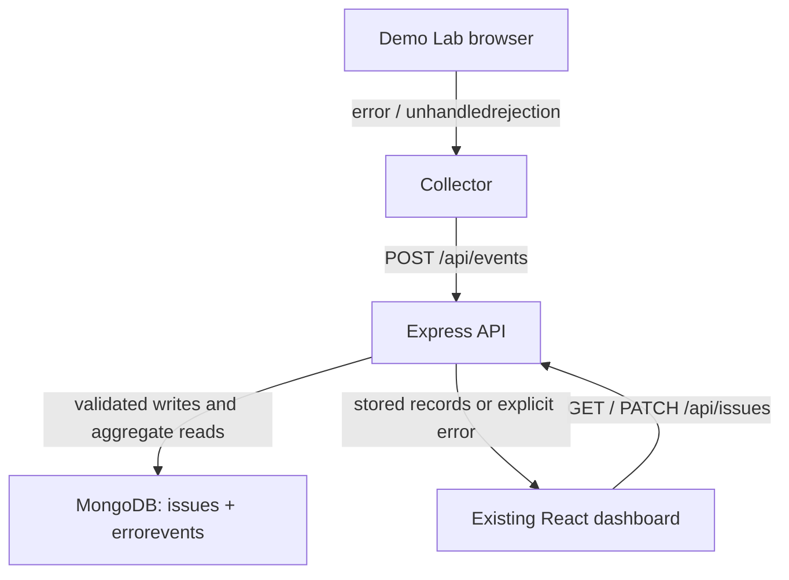

# DevTrace

A JavaScript error-monitoring prototype: capture browser failures, send them to an Express API, group persisted occurrences, and inspect them in the existing React dashboard.

Verification Status — October 22, 2026

DevTrace has successfully passed 25 automated unit/HTTP tests and 10 real MongoDB integration tests, with zero failures or skipped tests. The TypeScript/Vite production build also completed successfully.

Local manual testing confirmed JavaScript error collection, MongoDB persistence, issue grouping, and persistent issue resolution. Public full-stack deployment remains separate from the verified local implementation.

[Existing private Site](https://devtrace-lab-9f48.greylynx128.chatgpt.site/) · [Baseline audit](docs/AUDIT.md) · [Verification report](docs/VERIFICATION.md) · [Manual acceptance checklist](docs/MANUAL_TESTS.md) · [Technical case study](docs/CASE_STUDY.md)

## Problem and scope

Repeated JavaScript failures are difficult to investigate when they remain isolated console messages. DevTrace separates an **event** (one occurrence) from an **issue** (matching occurrences with a shared fingerprint and manual status). Its scope is a single application, a single controlled workspace, and synthetic test errors.

The existing visual identity, sidebar, navigation, dashboard cards, chart, issue table, detail drawer and Demo Lab are retained. This update changes the engineering behind live monitoring.

## Implemented features

- Express REST API with strict validation, bounded JSON, predictable JSON errors and readiness checks.
- Mongoose `Issue` and `ErrorEvent` models with unique indexes and real MongoDB operations.
- Deterministic server fingerprints and event-id idempotency. Occurrence counts and first/last timestamps are derived from stored event documents.
- Reusable collector for `error` and `unhandledrejection`, best-effort redaction, HTTP submission, bounded concurrency and guarded failure callbacks.
- Live dashboard requests, server pagination/filtering, full-range aggregate cards/chart, status updates, and explicit disconnected states.
- Clearly separated **Demo Data**, stored only in browser localStorage. No live localStorage fallback or automatic import of old browser captures.
- Local-first binding; exact CORS/Host allowlists, optional local bearer token, mandatory token for external binding, and basic per-process rate limits.
- Automated tests, a real-MongoDB integration suite and a GitHub Actions workflow. A workflow file is not evidence of a successful CI run.

## Stack and layout

React 19 / TypeScript / Vite frontend; JavaScript ES modules / Node.js / Express 5 / Mongoose 8 backend; MongoDB 7+. Use Node **22.12+** or Node 24. `package-lock.json` records the installed versions (Express 5.3.0, Mongoose 8.24.5 at verification).

| Path | Responsibility |
|---|---|
| `src/App.tsx`, `src/style.css` | Existing dashboard and minimal connection controls |
| `src/core.ts` | Demo fixtures, client sanitization/fingerprinting and pure display helpers |
| `src/collector.ts` | Browser listeners and bounded HTTP delivery through an injected sender |
| `src/api.ts`, `src/useLiveData.ts` | Fetch client, connection checks, refresh, cancellation and live state |
| `server/index.js`, `server/config.js` | Configuration, database initialization, process lifecycle |
| `server/app.js` | HTTP guards, five routes and consistent error responses |
| `server/validation.js` | Strict request validation, sanitization and canonical fingerprint |
| `server/models.js`, `server/repository.js` | MongoDB models, unique indexes, writes and aggregate reads |
| `test/` | Unit, HTTP, collector and real MongoDB integration tests |
| `compose.yaml` | Local MongoDB with a persistent Docker volume |
| `.github/workflows/verify.yml` | CI job with a real MongoDB 7 service |
| `docs/` | Audit, actual test evidence, manual checks and case study |

## Architecture



Demo Data is a separate frontend-only dataset. It is never inserted into MongoDB by this application.

## Run locally

Prerequisites: Node 22.12+ and either Docker Compose or an existing MongoDB **7+** instance. The API requires a real MongoDB connection and successful unique-index creation before it starts listening.

```bash
npm ci
cp .env.example .env
# Skip this command if a compatible MongoDB instance is already running.
docker compose up -d mongo
npm run server
```

In a second terminal:

```bash
npm run dev
```

Open `http://127.0.0.1:4173`. Choose **Live monitoring** or **Demo lab**. Leave the API base URL blank to use Vite's `/api` proxy to `127.0.0.1:3001`. Wait for **MongoDB connected**, then trigger a TypeError. Only an acknowledged server response produces a capture-success message.

For backend edits, `npm run server:watch` restarts the Node process. `npm run build` type-checks and builds the frontend; it does not package a running backend. `docker compose stop mongo` preserves the named volume. **Do not use `docker compose down -v` unless you intend to delete the stored data.**

This setup has been prepared and its non-database tests executed here; the complete setup still needs verification on a machine with MongoDB/Docker.

## Environment configuration

Copy `.env.example` to `.env`. `.env` and other secret variants are ignored by Git.

| Variable | Default / purpose |
|---|---|
| `MONGODB_URI` | `mongodb://127.0.0.1:27017/devtrace`; server-only MongoDB connection string |
| `HOST` | `127.0.0.1`; external binding requires the safeguards below |
| `PORT` | `3001` |
| `ALLOWED_ORIGINS` | Exact local frontend/API origins; comma-separated, no wildcard |
| `ALLOWED_HOSTS` | `127.0.0.1,localhost`; exact API hostnames, without ports |
| `API_TOKEN` | Optional on loopback; at least 32 characters when set; mandatory for network binding |
| `VITE_API_BASE_URL` | Public HTTPS API origin/base path only; blank uses same-origin `/api` |
| `TEST_MONGODB_URI` | Dedicated MongoDB instance for the integration suite |

Never prefix MongoDB credentials or API tokens with `VITE_`. Vite exposes `VITE_` variables in the browser bundle.

The **Connect API** dialog accepts a URL and token. The URL is remembered in tab sessionStorage. The token stays only in memory and must be re-entered after refresh; the database records remain stored. The browser still necessarily holds the token while making authorized requests. This is a shared credential for a controlled prototype, not user/account authentication.

## Hosting the existing Site with an external backend

The current Sites project is static. The platform's server runtime uses Cloudflare Workers and HTTP-based external connections, not a persistent Express process or raw MongoDB TCP connections. This repository keeps the frontend on the existing Site and prepares Express as a separate service.

1. Run `npm ci --omit=dev` and `node server/index.js` on a Node 22.12+ host with persistent process support, outbound MongoDB connectivity and an HTTPS reverse proxy.
2. Provide a real `MONGODB_URI` through that host's secret settings. Use database authentication and the appropriate network restrictions for the host.
3. Set `HOST=0.0.0.0`, `PORT` to the host's required port, and a randomly generated 32+ character `API_TOKEN` in server secrets. For example, generate one locally with `node -e "console.log(require('node:crypto').randomBytes(32).toString('hex'))"` and keep it private.
4. Set `ALLOWED_ORIGINS=https://devtrace-lab-9f48.greylynx128.chatgpt.site` and `ALLOWED_HOSTS` to the exact backend hostname. The reverse proxy must preserve the intended Host header. `trust proxy` is deliberately disabled.
5. Verify `GET /api/health` returns `database: connected`. Set `VITE_API_BASE_URL` to the backend HTTPS origin and rebuild the frontend, or enter that URL in **Connect API**. Enter the bearer token at runtime.
6. Run the real MongoDB integration suite and the browser acceptance checklist. Keep the Site private and the backend limited to controlled testing.

No external backend, MongoDB account or deployment credentials were available in this session. No external API has been provisioned. Do not configure the hosted HTTPS page to call a developer's local HTTP server: use the local Vite frontend for local development, or an HTTPS backend for the hosted Site.

## API

All responses are JSON, with `Cache-Control: no-store`. Success is `{ "ok": true, "data": ... }`. Failure is `{ "ok": false, "error": { "code", "message", "requestId" } }`. Request IDs are also returned in `X-Request-Id`. Secrets, raw payloads and database error messages are not logged or returned.

| Method / route | Behavior |
|---|---|
| `GET /api/health` | 200 only after an actual MongoDB ping; 503 otherwise. No bearer token required. |
| `POST /api/events` | Validate and insert one event; 201 new, 200 duplicate retry, 409 conflicting reuse of an ID. |
| `GET /api/issues` | Paginated issue aggregates plus summary/chart data and recent event summaries. |
| `GET /api/issues/:id` | Lifetime issue count/first/last/status and newest 20 complete occurrences; 404 if absent. |
| `PATCH /api/issues/:id` | Body `{ "status": "open" }` or `{ "status": "resolved" }`; returns refreshed detail. |

`:id` is the **64-character SHA-256 fingerprint**, not the internal MongoDB ObjectId.

Example event payload (an example, not execution evidence):

```json
{
  "eventId": "b765a2bc-2b69-4bc6-a934-65283cba38be",
  "clientTimestamp": 1792486800000,
  "type": "TypeError",
  "message": "Cannot read properties of null (reading 'map')",
  "kind": "error",
  "source": "/src/collector.ts",
  "line": 42,
  "column": 10,
  "page": "/",
  "stack": "TypeError: Cannot read properties of null (reading 'map')"
}
```

`eventId` must be UUID v4, generated once per occurrence. Reuse it only to retry the exact same payload. `type`, `message` and `kind` are required. Optional fields are `clientTimestamp`, `source`, `line`, `column`, `page`, `stack`. Unknown properties are rejected. Limits: 16 KiB uncompressed JSON body; type 64 characters; message/source/page 1,024 each; stack 8,192. Numeric fields must be nonnegative safe integers. Server receipt time is authoritative; client time is supplementary.

Issue query parameters: `range=24|168|all` (default 24), `status=all|open|resolved`, `kind=all|error|unhandledrejection`, literal `q` up to 80 characters, `page=1..99999`, `limit=1..100` (default 10). Search includes type, message, source and `DT-` fingerprint prefixes. Invalid query parameters receive 400.

The list returns `items`, `pagination`, `summary`, `activity` (48 bins), `window`, `generatedAt`, `recentEvents` and `eventsTruncated`. Summary cards and the main activity chart cover **all stored events in the selected time range**, independently of table search/status/kind filters. The event stream and JSON export are bounded to **1,000 recent event summaries**, without stack/page fields; inspect the issue detail API for complete recent occurrences. Stream search applies to this bounded set. The detail drawer uses lifetime statistics, so its count may exceed a time-filtered table count. Row sparklines cover the last 24 hours among the most recent 20 timestamps in the selected range.

Predictable failures include 400 validation/JSON/id/query errors, 401 missing or invalid token, 403 host/origin rejection, 404 missing issue/route, 409 event-id conflict, 413 oversized JSON, 415 wrong content type/compression, 429 rate limit, and 503 database unavailable. No failed submission is represented as a local success.

## Database and consistency design

`Issue` stores unique `fingerprint`, `status`, `createdAt` and `updatedAt`. `ErrorEvent` stores unique `eventId`, `fingerprint`, sanitized error fields, server `timestamp`, optional `clientTimestamp` and a private `payloadHash`. Event indexes support newest-event and issue/time access.

The server hashes the canonical JSON tuple:

```text
[1, type, normalizedMessage, sourcePathOrNull, lineOrNull, columnOrNull]
```

Normalization removes outer whitespace and normalizes line endings. URL query strings/fragments and common credential/email patterns are removed. Numeric message content is preserved. Stack, kind and client timestamp are not grouping inputs. Server/client fingerprint parity has a unit test. Different hosts with the same source path can merge; changing source positions or build hashes can split one underlying bug. Missing Promise rejection locations reduce discrimination. This is deterministic grouping, not root-cause inference or source-map processing.

Unique indexes are created before accepting traffic. Ingestion upserts issue metadata without resetting an existing status, then atomically upserts an event by unique event ID. A stored payload hash prevents silently accepting different data under the same ID. Counts and first/last timestamps are calculated from event documents with MongoDB aggregation, rather than maintaining a second counter that could drift during concurrent writes.

The two writes are not a transaction. A failed event write can leave empty issue metadata; listing starts from event documents, so empty metadata is not shown. A response lost after a committed event is ambiguous to the client; retrying the same ID avoids another occurrence. The built-in collector does not automatically retry or queue events offline. Concurrent status changes use last-write-wins semantics. Queries are not an atomic snapshot of concurrent status changes; a later refresh converges on the stored state.

## Security and operating limits

- Local defaults bind to loopback, validate Host and Origin, and do not expose MongoDB outside loopback through Compose.
- External binding refuses to start without a token and explicit origins/hosts. All ingestion and dashboard routes require the same token; health contains no event content.
- The collector allows 20 arrivals per 10 seconds and 10 in-flight submissions. The server allows 120 requests per minute per socket IP in one process, including polling. Proxy deployments may share one rate bucket; distributed limits are not implemented.
- The collector only observes the page on which it is installed while live monitoring is active. It does not capture handled exceptions, backend exceptions, other tabs/apps, workers or complete cross-origin stacks. It neither patches `console` nor suppresses the browser's native errors.
- Sanitization is best effort, not guaranteed anonymization. Use controlled synthetic errors, not real users' private data.
- Records have no automatic deletion/TTL policy. Monitor disk use and manage retention before expanding the prototype. The aggregate list uses bounded output and query timeouts but is not designed for large production datasets; MongoDB facet memory limits still apply.
- There is no multi-user authorization, release tracking, alerts, source maps, session replay, offline replay or production availability guarantee.

## Tests and real evidence

```bash
npm test
npm run build
# Dedicated local test instance; the suite creates and drops only a random devtrace_test_* database.
TEST_MONGODB_URI=mongodb://127.0.0.1:27017 npm run test:mongodb
```

| Check executed in this session | Result |
|---|---|
| Unit + real Express HTTP guard/failure tests + HTTP collector contract fixture | **Passed: 25/25**, 0 failed, 0 skipped |
| TypeScript + production Vite build | **Passed** |
| Real MongoDB integration attempt against local port 27017 | **Failed (environment prerequisite):** MongoDB unavailable; persistence assertions **Not Tested** |
| Real browser TypeError, Network panel, dashboard reload, responsive/keyboard flow | **Not Tested:** supported browser QA unavailable |
| External backend / hosted live API | **Not Tested / not configured** |
| GitHub Actions run | **Not Tested:** no repository push/run verified |

[Raw passing output](docs/test-output.txt) and [raw blocked MongoDB output](docs/mongodb-test-output.txt) are retained. HTTP fixtures acknowledge sample payloads only to test transport; they are explicitly not database evidence. The MongoDB suite has **no fake database**. It checks real collection contents, concurrent ingestion, retry idempotency, distinct issues, aggregate totals, status persistence, a fresh Node server process, collector-to-HTTP-to-MongoDB and API shutdown. With no `TEST_MONGODB_URI`, it is explicitly skipped; a configured but unreachable database fails the prerequisite.

The initial host-header assertion used Node fetch, which normalizes Host. The test was corrected to use raw HTTP to actually exercise the guard, and the final suite passes. This correction is not represented as database or browser verification.

## Screenshots

**Not captured in this session.** Supported browser automation was unavailable. No generated or mock screenshots are used as application evidence. Follow [the manual checklist](docs/MANUAL_TESTS.md), then save real screenshots of the live issue, its occurrences, Network request and status after reload under `docs/screenshots/`. Keep sensitive URLs, tokens and private records out of screenshots.

## Source and GitHub

The editable source belongs to the existing Site repository. GitHub installation was confirmed during this session, but repository/CLI capabilities were not exposed in the active runtime, so a GitHub repository URL or successful push cannot be claimed. Source, reproducible instructions and `.github/workflows/verify.yml` are prepared. No Git history was fabricated.

Once repository access is available, publish this exact source to a private `devtrace` repository, run **Verify DevTrace**, and replace this paragraph with the actual repository and CI URLs only after checking them. A source archive is also delivered with this update. The Site's internal source synchronization is distinct from a GitHub push.

## Portfolio and next work

The code was developed with AI assistance in ChatGPT Work. The student should reproduce the flow, inspect the tests, explain the decisions, and accurately identify their own subsequent work before presenting it as personal engineering experience. See the [case study](docs/CASE_STUDY.md).

The immediate gate is a green real-MongoDB suite and the manual browser flow. Then configure the external HTTPS API and capture real evidence. Production authentication, durable queues, retention and scale optimization are future work after that gate.

References: [Express 5 async error handling](https://expressjs.com/en/guide/error-handling/), [MongoDB atomicity and unique indexes](https://www.mongodb.com/docs/manual/core/write-operations-atomicity/), [Mongoose schemas and indexing](https://mongoosejs.com/docs/8.x/docs/guide.html). Hosting constraints were checked against the installed Sites platform reference; they were not inferred from the UI.
